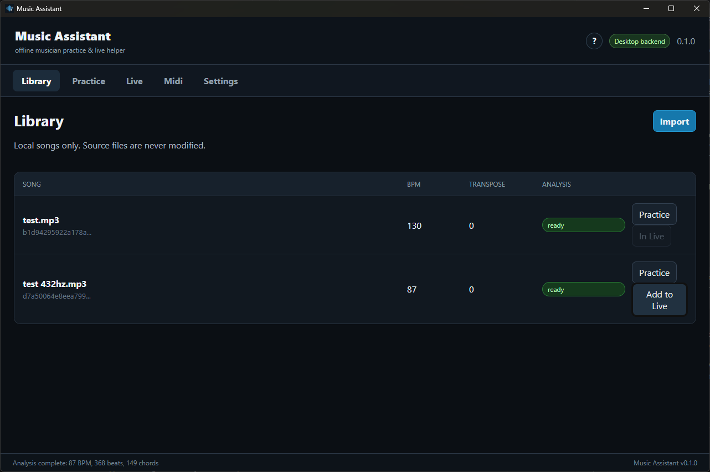
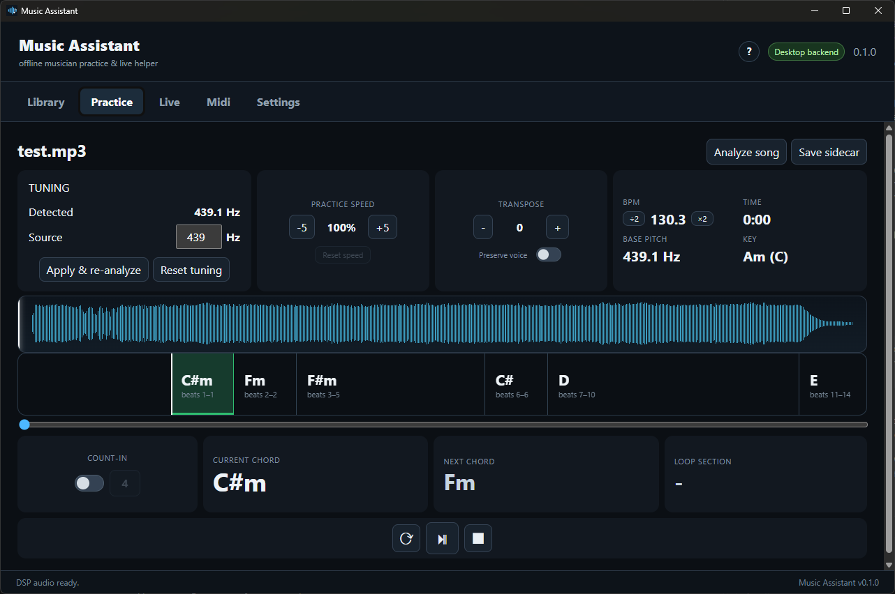
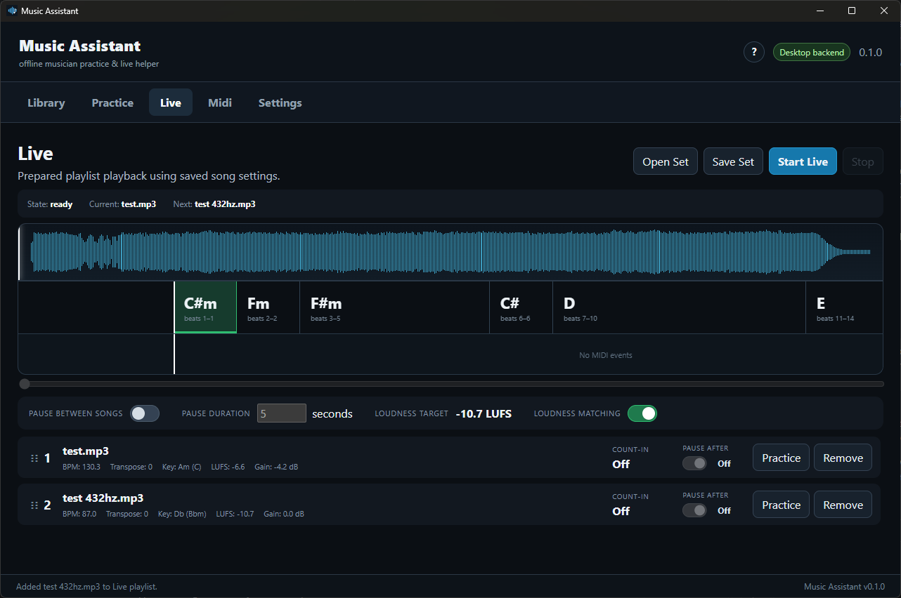
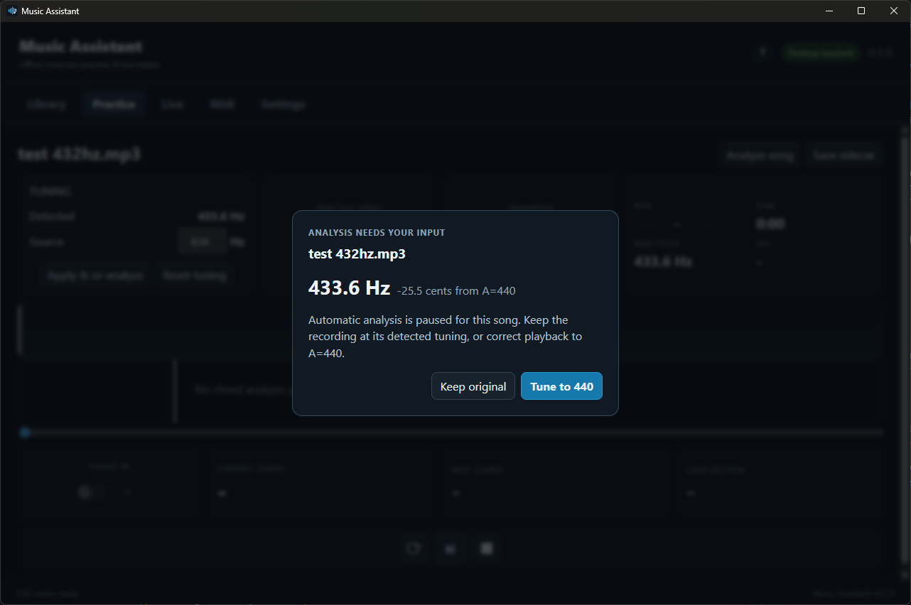
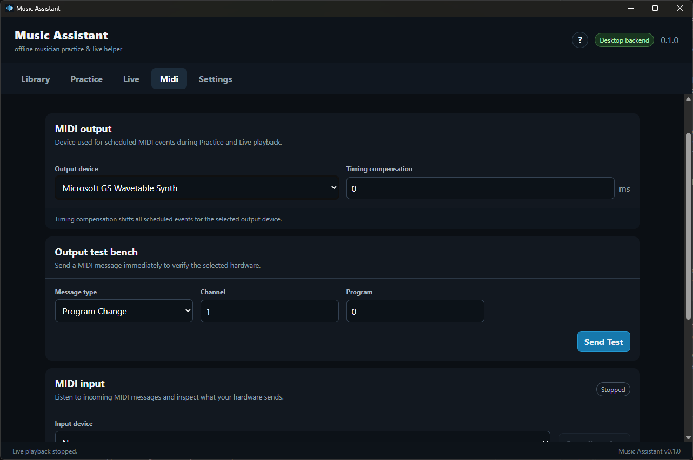
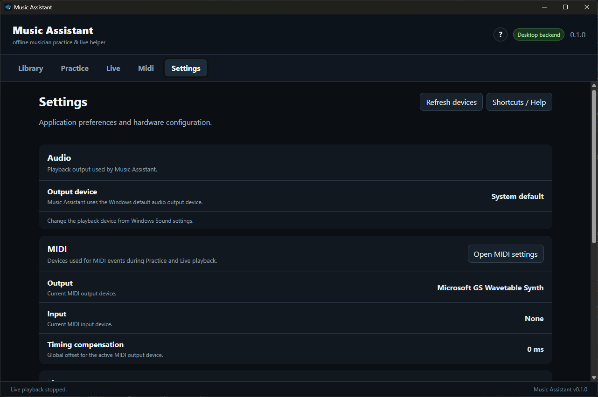

# Music Assistant

Offline-first practice and live-performance software for musicians working with local audio. Music Assistant combines song analysis, editable chord timelines, practice tools, playlists, and optional MIDI in a native desktop app.

> **Project status:** active pre-release development. The first four-platform GitHub Actions dry run succeeded; portable release packaging is being finalized before public distribution. No public production release is available yet.

## Features

- **Local library:** import MP3/WAV files or drag and drop them into the app.
- **Song analysis:** on-device tuning, BPM, beats, beat-aligned chords, key, waveform peaks, and loudness analysis.
- **Practice:** pitch-preserving speed control, transpose, independent tuning correction, count-in, START/END boundaries, and named loop sections.
- **Chord timeline:** edit detected chords and follow current/next chords during playback.
- **Live sets:** arrange local songs, configure per-song count-in and pause behavior, and play a set sequentially.
- **Loudness matching:** optional Live attenuation toward the quietest analyzed song; louder songs are never boosted.
- **Optional MIDI:** Program Change, Control Change, raw messages, MIDI input monitoring, and event copy/paste.
- **Scheduled MIDI:** beat/chord-anchored events with signed offsets and per-device timing compensation in both Practice and Live.
- **Portable data:** fingerprint-bound `.masidecar` song data and `.musicassistant` playlist/set files.
- **Keyboard help and diagnostics:** Settings page, device status, and global shortcut reference.

## Screenshots

These captures show the current app UI without personal song names or file paths.

<table>
  <tr>
    <td width="50%"></td>
    <td width="50%"></td>
  </tr>
  <tr>
    <td align="center"><strong>Library</strong></td>
    <td align="center"><strong>Practice</strong></td>
  </tr>
  <tr>
    <td width="50%"></td>
    <td width="50%"></td>
  </tr>
  <tr>
    <td align="center"><strong>Live</strong></td>
    <td align="center"><strong>Tuning choice</strong></td>
  </tr>
  <tr>
    <td width="50%"></td>
    <td width="50%"></td>
  </tr>
  <tr>
    <td align="center"><strong>MIDI</strong></td>
    <td align="center"><strong>Settings</strong></td>
  </tr>
</table>

## Platforms

The current manual release workflow targets:

| Platform | Architecture | Portable release artifact |
| --- | --- | --- |
| Windows | x64 | ZIP containing the standalone `MusicAssistant.exe` |
| Linux | x64 | AppImage (`.AppImage`) |
| macOS | Intel x64 | ZIP containing the `.app` bundle |
| macOS | Apple Silicon arm64 | ZIP containing the `.app` bundle |

These are the configured build targets, not a claim of public release certification. The Windows executable is unsigned, and macOS app bundles are not notarized. The Linux AppImage bundles GStreamer support for audio playback but still requires a compatible Linux system with WebKitGTK 4.1 and a compatible glibc.

## Local-first design and portable files

The app's core library, playback, analysis, and practice workflows run locally; no cloud account or network service is required for normal use. Analysis uses a locally bundled Essentia.js/WASM Web Worker. Network access is needed to install development dependencies and to use GitHub Actions for CI/releases.

Source audio is never modified. Per-song state is stored beside the audio as `<audio-file>.masidecar` (JSON), including analysis and user edits such as chords, MIDI events, sections, transpose, and tuning settings. Sidecars are schema-validated and associated with source audio using its SHA-256 fingerprint. A mismatched or unsupported sidecar is rejected rather than applied to the wrong song.

Live playlists and sets use portable `.musicassistant` JSON files.

## Architecture

- **Angular 21 + TypeScript** provide the UI and feature components/services.
- **Tauri 2 + Rust** provide the desktop shell, local file/fingerprint operations, and native MIDI integration.
- **Essentia.js/WASM in a Web Worker** handles analysis away from Angular's UI thread.
- **Signalsmith Stretch** powers pitch/time DSP; playback follows the operating-system default audio output.
- **Sidecar, playlist, and settings services** keep portable user data separate from source audio.
- **MIDI is optional:** device or send failures must not stop audio playback.

See [docs/ARCHITECTURE.md](docs/ARCHITECTURE.md) for service boundaries and data flows, and [docs/BEHAVIOR_CONTRACTS.md](docs/BEHAVIOR_CONTRACTS.md) for the product invariants.

## Development prerequisites

The desktop app is built with Tauri 2. Install the following for the platform you develop on:

### All platforms

- **Node.js `>=20.19.0`** (Node 22 is used in CI and recommended) and npm. npm is included with Node.js.
- **Rust stable via rustup**, with Cargo and `rustfmt`. On Windows, use the MSVC Rust toolchain.

### Windows

- **Visual Studio Build Tools** or Visual Studio with the **Desktop development with C++** workload selected. Install the workload as a whole; Tauri's Windows setup requires Microsoft's C++ build tools.
- **Microsoft Edge WebView2 Runtime.** It is normally already present on supported Windows 10/11 installations; install the Evergreen Runtime if missing.

### Linux

The release workflow uses Ubuntu 22.04. For Debian/Ubuntu development, install Tauri's system dependencies and the packaging tools used by CI:

```bash
sudo apt-get update
sudo apt-get install -y build-essential curl file libasound2-dev \
  libayatana-appindicator3-dev libssl-dev libwebkit2gtk-4.1-dev librsvg2-dev \
  libxdo-dev patchelf wget
```

Other Linux distributions need their equivalent WebKitGTK, GTK, and build dependencies; see the [Tauri v2 prerequisites](https://v2.tauri.app/start/prerequisites/).

### macOS

Install Xcode, or **Xcode Command Line Tools** for desktop-only development:

```bash
xcode-select --install
```

Full Xcode is required for Apple's mobile targets, which this project does not currently build.

## Run and build locally

Run these commands from the repository root:

```bash
npm ci
npm run doctor
npm run dev
```

`npm run dev` starts the native Tauri app with its frontend. `npm run frontend:dev` runs the Angular frontend alone at `http://127.0.0.1:4200`; native Tauri features are not available in that preview. `npm run setup` is an optional environment-check and dependency-install helper.

| Purpose | Command |
| --- | --- |
| Frontend unit tests | `npm test` |
| Unit tests with coverage | `npm run test:coverage` |
| Release-tool tests | `npm run test:release-tools` |
| TypeScript check | `npm run typecheck` |
| Production frontend build | `npm run frontend:build` |
| Rust tests | `npm run rust:test` |
| Rust formatting check | `npm run rust:fmt` |
| Rust compile check | `npm run rust:check` |
| Tauri app build without installer bundling | `npm run build:app` |
| Build a portable release artifact for this host | `npm run release:local` |
| Print expected package details without building | `npm run package:release -- --dry-run` |

The CI workflow runs these quality gates on Linux, Windows, and macOS. Hardware-dependent audio playback and MIDI behavior still need manual verification on the target machine.

## GitHub Actions release workflow

The release workflow is manual:

1. Open **GitHub → Actions → Release → Run workflow**.
2. Select the release branch.
3. Choose the semantic version bump: `patch`, `minor`, or `major`.
4. For a dry run, enable **Build all portable artifacts without committing, tagging, or publishing** and review the result before requesting a real release.

A dry run validates the synchronized version change, installs dependencies with `npm ci`, runs frontend/release-tool/Rust quality gates, builds all four portable artifacts, and uploads temporary workflow artifacts (retained for seven days). It does not commit, push, tag, or publish a GitHub Release.

A real run repeats validation, creates and pushes a synchronized version commit to the selected branch, builds the portable artifacts, and only then creates the `vX.Y.Z` tag and GitHub Release. The selected branch must allow the GitHub Actions token to push the version commit. Publishing is blocked unless every required portable artifact is present, and the publish command attaches only the four explicitly named portable files.

The portable files and Actions artifact bundles are named:

| Portable release file | Uploaded Actions artifact |
| --- | --- |
| `MusicAssistant-X.Y.Z-Windows-x64.zip` | `MusicAssistant-X.Y.Z-Windows-x64` |
| `MusicAssistant-X.Y.Z-Linux-x64.AppImage` | `MusicAssistant-X.Y.Z-Linux-x64` |
| `MusicAssistant-X.Y.Z-macOS-x64.zip` | `MusicAssistant-X.Y.Z-macOS-x64` |
| `MusicAssistant-X.Y.Z-macOS-arm64.zip` | `MusicAssistant-X.Y.Z-macOS-arm64` |

The Windows ZIP contains only `MusicAssistant.exe`; no app installation or additional adjacent files are required. The executable uses the Windows WebView2 Runtime, which is included with supported Windows versions. Each macOS ZIP contains the corresponding `.app` bundle.

See [docs/RELEASING.md](docs/RELEASING.md) for branch permissions, version synchronization, and local packaging details. The first workflow run should be a dry run.

## Contributing

Contributions should preserve the local-first model, source-audio immutability, portable sidecar behavior, and existing MIDI/playback reliability contracts. Read [CONTRIBUTING.md](CONTRIBUTING.md), [docs/PROJECT_CONTEXT.md](docs/PROJECT_CONTEXT.md), and the [architecture decisions](docs/ARCHITECTURE_DECISIONS.md) before changing core behavior.

## Project documentation

- [Architecture](docs/ARCHITECTURE.md)
- [Behavior contracts](docs/BEHAVIOR_CONTRACTS.md)
- [Portable data formats](docs/DATA_FORMATS.md)
- [Architecture decisions](docs/ARCHITECTURE_DECISIONS.md)
- [Project context](docs/PROJECT_CONTEXT.md)
- [Roadmap and chapter status](docs/ROADMAP.md)
- [Release workflow](docs/RELEASING.md)
- [Historical Chapter 8 baseline](docs/CURRENT_STATE_AFTER_CHAPTER_8.md)

## License

Music Assistant is licensed under **AGPL-3.0-or-later**. See [LICENSE](LICENSE) for the complete license text.
